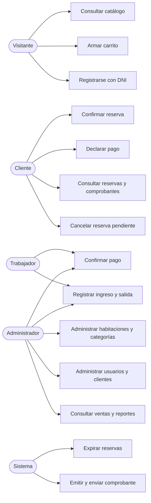
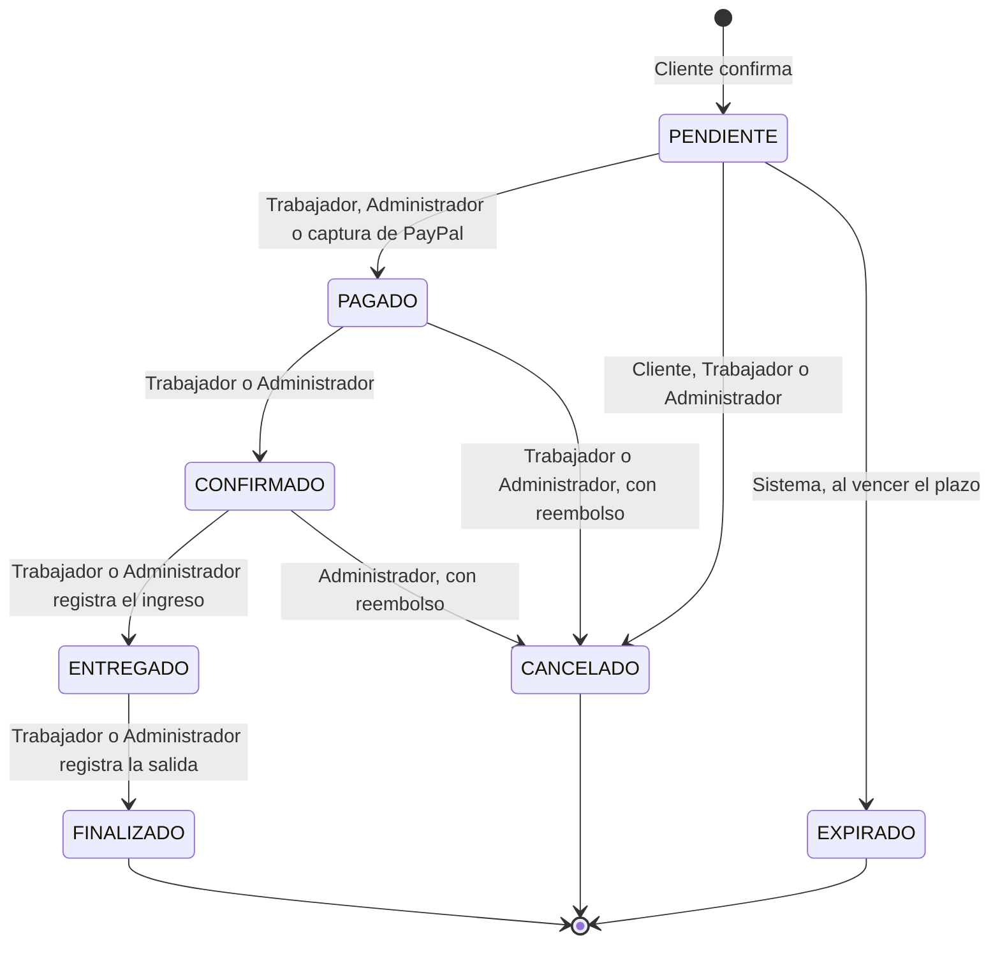
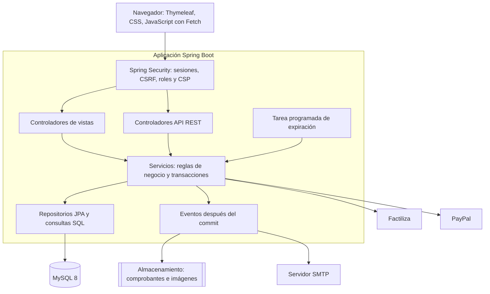
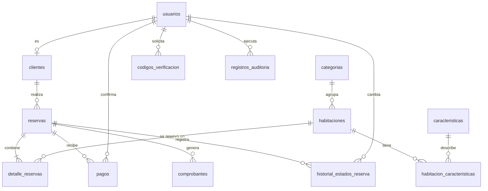

# Entregable 1: Análisis y diseño

Sistema de Reservas Hotel Inti Wasi. Unidad didáctica Taller de Programación Web, IESTP "José Pardo", semestre 2026-II.

## 1. Decisiones tecnológicas

El Prompt Maestro recomienda PHP, pero el sílabo fija Java y Spring. Se eligió el sílabo y se reemplazó cada pieza por su equivalente. El prompt admite cambiar de stack si la solución se mantiene coherente con la tecnología elegida.

| Prompt Maestro | Solución adoptada | Motivo |
|---|---|---|
| PHP 8.2 | Java 21 | Sílabo, sección V |
| MVC nativo | Spring Boot 3.5.16 (Spring MVC) | Es la última línea compatible con Tomcat 10.1 |
| Vistas PHP | Thymeleaf | Sílabo, ficha 11 |
| PDO | Spring Data JPA y `NamedParameterJdbcTemplate` | Sílabo, ficha 12; siempre con parámetros enlazados |
| Dompdf | OpenHTMLtoPDF 1.1.37 | Mismo modelo: de HTML a PDF |
| PHPMailer | Spring Mail (Jakarta Mail) por SMTP | Equivalente directo en Java |
| Composer | Maven | Sílabo, ficha 1 |
| Middleware | Spring Security y filtros | Equivalente en Spring |
| Lucide Icons | Sprite SVG local con iconos Lucide | Funciona sin CDN durante la sustentación |
| Librería de gráficos | Módulo SVG propio (`graficos.js`) | Sin dependencias externas y compatible con la CSP |

**Spring Boot 3.5 frente a 4.** La bibliografía del sílabo menciona Spring Boot 4, pero esa línea exige Servlet 6.1, que Tomcat 10.1 no ofrece. El laboratorio usa Tomcat 10.1, por lo que se usa 3.5.16, el último parche publicado. Su soporte gratuito terminó el 30 de junio de 2026. Para un despliegue comercial real habría que migrar a Spring Boot 4 con Tomcat 11.

## 2. Contradicciones detectadas y cómo se resolvieron

| # | Contradicción o ambigüedad | Resolución |
|---|---|---|
| 1 | PHP en el prompt, Java en el sílabo | Java con Spring Boot, confirmado por el autor del proyecto |
| 2 | El prompt pide cookies `Secure`, pero el laboratorio usa HTTP | `SESION_COOKIE_SEGURA` se activa en producción con HTTPS |
| 3 | "Boleta PDF" y "no confundir con un comprobante tributario" | El documento se llama **Comprobante de reserva** e indica que no es un comprobante de pago electrónico SUNAT |
| 4 | El prompt pide pagos, pero no define una pasarela | Se usan efectivo, PayPal y Yape, a pedido del autor. Efectivo y Yape los confirma un trabajador; PayPal se confirma con su API |
| 4a | PayPal no admite soles (`PEN`) | Se cobra en dólares con un tipo de cambio configurable. El importe en soles sigue siendo el oficial del sistema |
| 4b | No hay API pública oficial de Yape para comercios | Pago con QR o número configurados, número de operación y verificación manual |
| 5 | El estado "Entregado" proviene de un sistema de ventas | Significa **habitación entregada al huésped**, es decir, ingreso registrado |
| 6 | "Stock" no aplica a habitaciones únicas | La tabla `habitaciones` usa el campo `estado` en lugar de stock: Disponible, Reservada, Ocupada, En mantenimiento o Fuera de servicio. Al pagarse una reserva la habitación pasa a Reservada, al ingresar el huésped a Ocupada y al salir o cancelarse vuelve a Disponible. El reporte 4 muestra ese estado y la ocupación por fecha |
| 7 | "Cambiar fechas" y "fechas por reserva" | Las fechas pertenecen a la reserva, por lo que todas las habitaciones de un carrito comparten estancia |
| 8 | Ingresos reales y reservas canceladas ya pagadas | Cancelar una reserva pagada marca el pago como `REEMBOLSADO` y deja de contar como ingreso |
| 9 | Precios e impuestos | `precio_noche` no incluye IGV. El catálogo lo indica como "+ IGV" |
| 10 | "Los pedidos no cancelados al final del día serán eliminados" | "Cancelar" se entiende como pagar. El plazo de pago vence a las 23:59 del día en que se hizo la reserva y el cierre diario (23:59) da de baja y elimina los pedidos no pagados, salvo los que tienen un pago declarado por verificar |
| 11 | El administrador olvida su contraseña y el correo no está configurado | Además del código por correo, puede usar la clave de recuperación `ADMIN_CLAVE_RECUPERACION` en `/recuperar-contrasena/administrador` |
| 12 | Total en letras | El comprobante imprime al pie "SON: … CON xx/100 SOLES" |

## 3. Descripción del problema

Un hotel que atiende reservas por teléfono o en recepción sufre cruces de fechas, cobros difíciles de conciliar y poca visibilidad sobre su ocupación e ingresos. Un campo "disponible" no resuelve el problema, porque una habitación puede estar libre esta semana y ocupada la siguiente. Dos personas que reservan a la vez también pueden quedarse con la misma habitación.

## 4. Objetivos

**General.** Desarrollar una plataforma web que gestione de principio a fin las reservas de un hotel, mantenga la integridad de la disponibilidad y ofrezca información confiable para la administración.

**Específicos.**

1. Permitir al cliente consultar habitaciones, verificar disponibilidad por fechas y reservar en línea.
2. Impedir reservas superpuestas, incluso con solicitudes simultáneas.
3. Controlar el ciclo de la reserva mediante estados y transiciones autorizadas por rol.
4. Emitir comprobantes PDF y enviarlos por correo, dejando registro del resultado.
5. Ofrecer al personal herramientas de operación, administración, ventas y reportes.
6. Proteger cuentas y datos personales con controles de seguridad verificables.

## 5. Alcance

**Incluye:** catálogo y filtros, registro con DNI, recuperación de contraseña, carrito, reserva por etapas, pagos con efectivo, PayPal y Yape, comprobantes, correo, expiración automática, panel de trabajador, administración, ventas, seis reportes con exportación, auditoría.

**No incluye:** cobro automático de Yape, reembolsos automáticos, facturación electrónica ante SUNAT, varias sedes, tarifas por temporada, cuentas de empresas ni aplicación móvil nativa.

## 6. Actores

| Actor | Descripción |
|---|---|
| Visitante | Consulta el catálogo y arma su carrito sin cuenta |
| Cliente | Reserva, paga, consulta sus reservas y comprobantes |
| Trabajador | Confirma pagos y gestiona ingresos y salidas |
| Administrador | Administra todo el sistema y consulta reportes |
| Sistema | Expira reservas y envía comprobantes |
| Factiliza | Servicio externo de consulta de DNI |
| Servidor SMTP | Servicio externo de correo |
| PayPal | Servicio externo de cobro en línea |

## 7. Requerimientos funcionales

| Código | Requerimiento | Rol |
|---|---|---|
| RF-01 | Buscar y filtrar habitaciones por texto, categoría, precio y capacidad, y ordenar por precio | Público |
| RF-02 | Consultar disponibilidad por fechas | Público |
| RF-03 | Registrarse con DNI, autocompletando nombres mediante Factiliza | Visitante |
| RF-04 | Iniciar y cerrar sesión | Todos |
| RF-05 | Recuperar la contraseña con un código OTP por correo | Todos |
| RF-06 | Gestionar el carrito: agregar, quitar, vaciar, cambiar fechas y huéspedes | Público |
| RF-07 | Registrar una reserva en cinco etapas | Cliente |
| RF-08 | Pagar con PayPal o declarar un pago en efectivo o Yape | Cliente |
| RF-09 | Consultar reservas y descargar comprobantes propios | Cliente |
| RF-10 | Actualizar datos permitidos y contraseña | Cliente |
| RF-11 | Cancelar una reserva pendiente propia | Cliente |
| RF-12 | Confirmar o rechazar pagos | Trabajador, Administrador |
| RF-13 | Registrar ingreso y salida de huéspedes | Trabajador, Administrador |
| RF-14 | Ver el dashboard administrativo | Administrador |
| RF-15 | Administrar habitaciones y categorías | Administrador |
| RF-16 | Administrar usuarios, roles y clientes | Administrador |
| RF-17 | Consultar ventas con filtros y detalle en modal | Administrador |
| RF-18 | Consultar seis reportes con exportación PDF y Excel | Administrador |
| RF-19 | Editar la configuración del hotel | Administrador |
| RF-20 | Expirar reservas vencidas de forma automática | Sistema |
| RF-21 | Generar y enviar comprobantes, registrando el resultado | Sistema |
| RF-22 | Registrar la auditoría de operaciones administrativas | Sistema |

## 8. Requerimientos no funcionales

| Código | Categoría | Requerimiento |
|---|---|---|
| RNF-01 | Seguridad | Contraseñas con Argon2id; protección CSRF y XSS; consultas parametrizadas |
| RNF-02 | Seguridad | Control de acceso por rol en el servidor y validación de propiedad de cada reserva |
| RNF-03 | Seguridad | Límite de solicitudes en consulta de DNI, recuperación e inicio de sesión |
| RNF-03a | Disponibilidad | Límite de tráfico por IP, bloqueo temporal y tope de exportaciones simultáneas |
| RNF-04 | Integridad | Transacciones y bloqueos para evitar reservas duplicadas |
| RNF-05 | Mantenibilidad | Arquitectura por capas con responsabilidad única |
| RNF-06 | Usabilidad | Interfaz responsive con estados de carga, vacío y error |
| RNF-07 | Portabilidad | Ejecutable con Tomcat embebido o desplegado en Tomcat 10.1 |
| RNF-08 | Configuración | Secretos solo en variables de entorno |
| RNF-09 | Idioma | Código, base de datos, interfaz y documentación en español peruano |

## 9. Casos de uso



### Caso de uso principal: registrar una reserva

| Elemento | Descripción |
|---|---|
| Actor | Cliente con sesión iniciada |
| Precondición | El carrito tiene fechas y al menos una habitación |
| Flujo principal | 1. El cliente revisa el resumen y confirma. 2. El sistema valida cliente, fechas y capacidad. 3. Bloquea las habitaciones en orden. 4. Verifica que no existan cruces. 5. Recalcula importes. 6. Registra la reserva, sus detalles y su historial. 7. Confirma la transacción. 8. Genera el comprobante. 9. Lo envía por correo y registra el resultado |
| Flujo alterno | Si una habitación ya no está disponible, se revierte todo y el cliente recibe el motivo |
| Postcondición | Reserva `PENDIENTE` con fecha límite de pago |

## 10. Reglas de negocio

| Código | Regla |
|---|---|
| RN-01 | La fecha de entrada no puede ser anterior a hoy |
| RN-02 | La salida debe ser posterior a la entrada. La estancia máxima es de 30 noches |
| RN-03 | Noches = salida − entrada. El día de salida no ocupa noche |
| RN-04 | Dos estancias se cruzan si `entrada_existente < salida_nueva` y `salida_existente > entrada_nueva` |
| RN-05 | Bloquean disponibilidad: `PENDIENTE` no vencida, `PAGADO`, `CONFIRMADO`, `ENTREGADO` |
| RN-06 | No bloquean: `FINALIZADO`, `CANCELADO`, `EXPIRADO`, ni una `PENDIENTE` vencida |
| RN-07 | Los importes siempre se recalculan en el servidor |
| RN-08 | Subtotal = suma de precio por noche × noches. Descuento según la configuración de estadía larga. IGV sobre subtotal menos descuento. Total = base + IGV |
| RN-09 | Cada habitación admite huéspedes hasta su capacidad |
| RN-10 | Una reserva pendiente expira a las horas configuradas (24 por defecto) |
| RN-11 | Declarar un pago extiende el plazo según las horas de verificación configuradas (12 por defecto) |
| RN-12 | El pago se registra por el total de la reserva. No hay pagos parciales |
| RN-13 | Los ingresos se calculan solo con pagos `CONFIRMADO` y por su fecha de pago |
| RN-14 | Las reservas nunca se eliminan físicamente |
| RN-15 | Una habitación o categoría con dependencias se desactiva, no se elimina |
| RN-16 | El ingreso no puede registrarse antes de la fecha de entrada |
| RN-17 | El sistema mantiene siempre al menos un administrador activo |
| RN-18 | Un cliente tiene un solo DNI y cada DNI pertenece a un solo cliente |
| RN-19 | PayPal cobra `total en soles / tipo de cambio`, redondeado a 2 decimales. Si no hay tipo de cambio o credenciales, el método no se ofrece |
| RN-20 | PayPal confirma la reserva solo si la captura está `COMPLETED` y el monto coincide con el esperado |
| RN-21 | Un número de operación de Yape no puede repetirse en otro pago vigente |

### Flujo de estados



## 11. Arquitectura

Aplicación monolítica modular en capas, con patrón MVC. Las vistas se renderizan con Thymeleaf y obtienen los datos mediante una API JSON propia.



### Prevención de reservas duplicadas

1. La transacción bloquea las filas de las habitaciones con `SELECT ... FOR UPDATE`, ordenadas por identificador para evitar interbloqueos.
2. Con el bloqueo tomado, verifica si existe un cruce de fechas.
3. Registra la reserva y confirma la transacción.

Una segunda solicitud sobre la misma habitación espera a que termine la primera, y entonces ve la reserva ya registrada y recibe un conflicto `409`.

### Comprobante y correo fuera de la transacción

Un evento se procesa después del commit. Así, un fallo de PDF o de SMTP nunca revierte una reserva válida. El resultado queda en la tabla `comprobantes`, y el PDF puede regenerarse al descargarlo.

### Contrato de respuesta JSON

```json
{
  "exito": true,
  "mensaje": "Operación realizada.",
  "datos": {},
  "errores": null,
  "codigo": null
}
```

## 12. Diagrama entidad-relación



## 13. Modelo relacional

Cada tabla usa `id` como clave primaria, salvo `configuraciones` (`clave`) y `habitacion_caracteristicas` (clave compuesta). `FK` indica clave foránea.

| Tabla | Columnas principales |
|---|---|
| usuarios | id, correo (UNIQUE), contrasena_hash, rol, nombres, apellidos, activo, intentos_fallidos, bloqueado_hasta, ultimo_acceso, creado_en, actualizado_en |
| clientes | id, usuario_id (FK, UNIQUE), dni (UNIQUE), telefono, direccion, dni_verificado, origen_datos, creado_en, actualizado_en |
| categorias | id, nombre (UNIQUE), descripcion, activo, creado_en, actualizado_en |
| caracteristicas | id, nombre (UNIQUE), icono |
| habitaciones | id, numero (UNIQUE), nombre, categoria_id (FK), descripcion, capacidad, precio_noche, estado, imagen_principal, activo, creado_en, actualizado_en |
| habitacion_caracteristicas | habitacion_id (FK), caracteristica_id (FK) |
| reservas | id, codigo (UNIQUE), cliente_id (FK), fecha_entrada, fecha_salida, cantidad_huespedes, subtotal, descuento, impuesto, total, estado, metodo_pago, fecha_pago, expira_en, observaciones, creado_en, actualizado_en |
| detalle_reservas | id, reserva_id (FK), habitacion_id (FK), cantidad_huespedes, precio_noche, noches, subtotal, descuento, impuesto, total |
| pagos | id, reserva_id (FK), metodo, monto, numero_operacion, referencia_externa (UNIQUE), moneda_externa, monto_externo, tipo_cambio, estado, registrado_por (FK), confirmado_por (FK), fecha_pago, motivo_rechazo, creado_en, actualizado_en |
| comprobantes | id, reserva_id (FK), numero (UNIQUE), ruta_archivo, estado_pago, fecha_emision, correo_destino, correo_estado, correo_detalle, correo_fecha |
| codigos_verificacion | id, usuario_id (FK), proposito, codigo_hash, intentos, expira_en, usado_en, invalidado_en, creado_en |
| historial_estados_reserva | id, reserva_id (FK), estado_anterior, estado_nuevo, usuario_id (FK), actor, motivo, creado_en |
| registros_auditoria | id, usuario_id (FK), accion, entidad, entidad_id, detalle, direccion_ip, creado_en |
| configuraciones | clave (PK), valor, descripcion, tipo, actualizado_en |

Normalización: los nombres viven solo en `usuarios`; `clientes` guarda únicamente los datos propios del cliente. `detalle_reservas` conserva el precio de cada noche para que un cambio futuro de tarifas no altere reservas pasadas.
